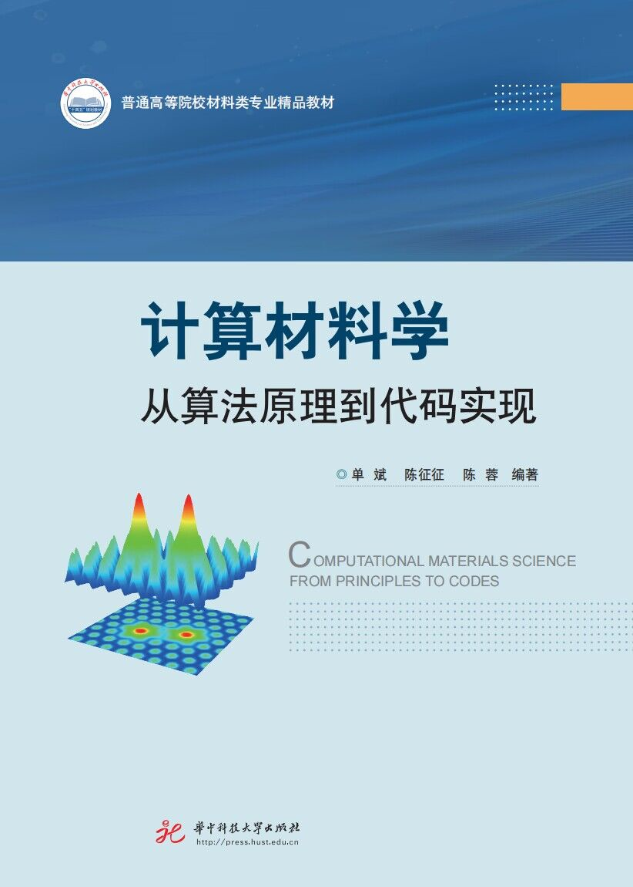

# 《计算材料学 -- 从算法原理到代码实现》

**单斌 &nbsp; 陈征征 &nbsp; 陈蓉 &nbsp; 编著**

**华中科技大学出版社 &nbsp; 2023**

---

本仓库为教材《计算材料学——从算法原理到代码实现》的配套代码与算例资源，涵盖第一性原理计算、分子动力学、蒙特卡罗方法等计算材料学核心方法的算法实现与实例演示。

## 快速导航

| 章节 | 主题 | 代码 |
|:---:|:---|:---:|
| 前置 | Python 与科学计算基础 | [Prerequisite](Prerequisite/) |
| 第一章 | 数学基础 | [Chapter01](Chapter01/) |
| 第三章 | 第一性原理的微观计算模拟 | [Chapter03](Chapter03/) |
| 第四章 | VASP 计算模拟实例 | [Chapter04](Chapter04/) |
| 第六章 | 分子动力学方法 | [Chapter06](Chapter06/) |
| 第七章 | LAMMPS 分子动力学实例 | [Chapter07](Chapter07/) |
| 第八章 | 蒙特卡罗方法 | [Chapter08](Chapter08/) |

---

## 学习资源

下表整理了每章节配套的视频教程、Jupyter Notebook、计算代码与输入文件等学习资源。视频教程主要发布在 Bilibili，部分 Notebook 配有 Bohrium 在线运行镜像。

<b>前置 &nbsp; Python 与科学计算基础</b>

| 节 | 主题 | 资源 |
|:---:|:---|:---|
| 0.0 | Python 与科学计算（上） | [Bohrium Notebook](https://nb.bohrium.dp.tech/detail/9319734448) |
| 0.1 | Python 与科学计算（下） | [Bohrium Notebook](https://nb.bohrium.dp.tech/detail/7014770587) |
| 0.2 | 用 Python 探索分形几何 | [Notebook](Prerequisite/session_用Python探索分形几何.ipynb) |

<b>第一章 &nbsp; 数学基础</b>

| 节 | 主题 | 资源 |
|:---:|:---|:---|
| 1.1.2 | 矩阵本征值计算 | [代码 eigenValue.py](Chapter01/eigenValue.py) |
| 1.1.3 | 矩阵 LU 分解 | [代码 LUdecomposition.py](Chapter01/LUdecomposition.py) |
| 1.1.3 | 矩阵奇异值分解 | [代码 SVD.py](Chapter01/SVD.py) |
| 1.3.1 | 最速下降法 | [视频 概念](https://www.bilibili.com/video/BV1z94y1z7k4/) · [视频 Python 实现](https://www.bilibili.com/video/BV1tz4y1M7Gy/) · [Notebook](Chapter01/1_3_1_最速下降法Python实现.ipynb) |
| 1.3.4 | 一维搜索算法 | [视频](https://www.bilibili.com/video/BV1MJB4YbEyR/) |
| 1.3.6 | 线性回归与最小二乘 | [视频 概念](https://www.bilibili.com/video/BV1yt421H7EP/) · [视频 Python 实现](https://www.bilibili.com/video/BV1RA4m1P7Kk/) · [Notebook](Chapter01/1_3_6_线性回归与最小二乘.ipynb) · [Bohrium 镜像](https://bohrium.dp.tech/notebooks/83866391785) · [数据 income.csv](Chapter01/income.csv) |
| 1.3.6 | 高阶最小二乘 | [代码 PolyLeastSquaresFitting.py](Chapter01/PolyLeastSquaresFitting.py) |
| 1.5.3 | 辛普森积分法 | [代码 simpsonIntegral.py](http://www.materialssimulation.com/Book_CompMat/simpsonIntegral.txt) |

<b>第二章 &nbsp; 量子力学和固体物理基础</b>

| 节 | 主题 | 资源 |
|:---:|:---|:---|
| 2.1.2 | 薛定谔方程 | [视频](https://www.bilibili.com/video/BV1nG41117m8) |
| 2.1.4 | 动量算符 | [视频](https://www.bilibili.com/video/BV1Yt4y1d7Yn/) |
| 2.1.5 | 一维无穷深势阱 | [视频](https://www.bilibili.com/video/BV1mH4y1r7iw/) |
| 2.1.5 | 一维势阱的节点定理 | [视频](https://www.bilibili.com/video/BV1XC4y127cG/) |

<b>第三章 &nbsp; 第一性原理的微观计算模拟</b>

| 节 | 主题 | 资源 |
|:---:|:---|:---|
| 3.1.4 | 多电子波函数与 Hartree 乘积 | [视频](https://www.bilibili.com/video/BV1Hc411S71R/) |
| 3.1.4 | Slater 行列式与交换关联 | [视频](https://www.bilibili.com/video/BV1fC4y1K7SJ/) |
| 3.1.4 | 单电子积分 | [视频](https://www.bilibili.com/video/BV18t4y1d7Bs/) |
| 3.1.4 | 双电子积分 | [视频](https://www.bilibili.com/video/BV1ZA4m1F7dw/) |
| 3.1.5 | HF 总能表达式 | [视频](https://www.bilibili.com/video/BV1xF4m1K7Ln/) |
| 3.1.5 | 库伦积分 J 与交换积分 K | [Notebook](Chapter03/3_1_5_库伦积分J与交换积分K实例.ipynb) |
| 3.1.5 | 非正则 Hartree-Fock 方程 | [视频](https://www.bilibili.com/video/BV1pm411m7cP/) |
| 3.1.5 | 正则 Hartree-Fock 方程 | [视频](https://www.bilibili.com/video/BV17t421P7xR/) |
| 3.1.7 | 闭壳层体系中的 Hartree-Fock 方程 | [视频](https://www.bilibili.com/video/BV1wZ421J71U/) |
| 3.1.9 | Hartree-Fock-Roothaan 方程 | [视频](https://www.bilibili.com/video/BV15T421X7Rh/) |
| 3.1.10 | Koopmans 定理 | [视频](https://www.bilibili.com/video/BV1xu4m1F7cC/) |
| 3.1.11 | 均匀电子气模型动能项 | [视频](https://www.bilibili.com/video/BV1RT421X7bQ/) |
| 3.1.12 | Slater 基与 Gauss 基 | [视频](https://www.bilibili.com/video/BV1hC4y1n7kD/) · [Notebook](Chapter03/3_1_12_Slater基与Gauss基.ipynb) · [Bohrium 镜像](https://nb.bohrium.dp.tech/detail/9659461514) |
| 3.1.12 | 缩并高斯基与 STO-nG 命名法则 | [视频](https://www.bilibili.com/video/BV1sb4y157ri/) |
| 3.1.12 | 缩并高斯基系数确定 | [Colab Notebook](https://colab.research.google.com/drive/1-5qMvChNpOMuVVKyP7wBiwoPT1Nn-0T7) · [Bohrium 镜像](https://nb.bohrium.dp.tech/detail/25386676824) |
| 3.8.3 | RuO₂ 表面相图计算 | [视频](https://www.bilibili.com/video/BV1C7kYBMENb/) · [VASP 输入 O-bri](Chapter03/3.8.3_RuO2_surface_diagram/O_bri/) · [O-cus](Chapter03/3.8.3_RuO2_surface_diagram/O_cus/) · [Ru-term](Chapter03/3.8.3_RuO2_surface_diagram/Ru_term/) |

<b>第四章 &nbsp; VASP 计算模拟实例</b>

| 节 | 主题 | 资源 |
|:---:|:---|:---|
| 4.1 | VASP 编译安装 | [视频 Ubuntu 编译](https://www.bilibili.com/video/BV1W24y1N7WK) · [视频 Intel OneAPI 编译](https://www.bilibili.com/video/BV1tN411D7Hn/) |
| 4.2 | 辅助建模软件 ASE | [视频](https://www.bilibili.com/video/BV1SMsoecEv6/) · [Notebook](Chapter04/4_2_辅助建模软件ASE生成纳米结构.ipynb) |
| 4.3 | VASPKIT 软件介绍 | [视频](https://www.bilibili.com/video/BV1kV4y1i7nc/) |
| 4.4 | 氢原子能量 VASP 计算 | [视频](https://www.bilibili.com/video/BV1vu4y1m7us/) · [VASP 输入](Chapter04/Chap_4.4_H_atom/) |
| 4.4 | 氧原子能量 VASP 计算 | [视频](https://www.bilibili.com/video/BV1hV411K7r3/) · [VASP 输入](Chapter04/Chap_4.4_O_atom/) |
| 4.4 | 氧分子结合能与电荷重分布 | [视频](https://www.bilibili.com/video/BV1LP411t7bu/) · [VASP 输入](Chapter04/Chap_4.4_O2_molecule/) |
| 4.5.2 | Jmol 可视化乙醇分子振动 | [视频](https://www.bilibili.com/video/BV1Zo4y1V7vk/) |
| 4.6 | 平衡晶格常数计算 | [bash 脚本](Chapter04/Chap_4.6_lattice_constant/lattice_constant.sh) |
| 4.12 | Materials Studio + ASE 建表面模型 | [视频](https://www.bilibili.com/video/BV1sW4y1d7vD/) |
| 4.12 | 对称模型表面能 | [视频](https://www.bilibili.com/video/BV1DM4y1W7GC/) · [VASP 输入](Chapter04/Chap_4.12_Surf_Energy/symmetric/) |
| 4.12 | 非对称模型表面能 | [视频](https://www.bilibili.com/video/BV1jV411L7V3/) · [VASP 输入 非弛豫](Chapter04/Chap_4.12_Surf_Energy/asymmetric/1.fix/) · [VASP 输入 弛豫](Chapter04/Chap_4.12_Surf_Energy/asymmetric/2.relax/) |
| 4.12 | 基于表面能的 Wulff 构建 | [视频](https://www.bilibili.com/video/BV16N411a7k4/) |
| 4.14 | Pt 表面 CO 吸附能 | [视频](https://www.bilibili.com/video/BV1CN411L7ta/) · [VASP 输入](Chapter04/Chap_4.14_CO_ads_Pt(111)/) |
| 4.14 | CO 吸附零点能校正 | [视频](https://www.bilibili.com/video/BV1Mw411E7RM/) |
| 4.14 | 气体吸附能热力学校正 | [视频](https://www.bilibili.com/video/BV1eVmRYzEmt/) |

<b>第六章 &nbsp; 分子动力学方法</b>

| 节 | 主题 | 资源 |
|:---:|:---|:---|
| 6.1 | 分子动力学简介 | [视频](https://www.bilibili.com/video/BV1QX4y1s7VU/) |
| 6.1.1 | 分子动力学基本步骤 | [视频](https://www.bilibili.com/video/BV1H94y1z7H2/) |
| 6.1.2 | Lyapunov 不稳定性 | [视频](https://www.bilibili.com/video/BV1pC411H7gE/) · [Notebook](Chapter06/6_1_2_三体问题Lyapunov不稳定性.ipynb) · [Bohrium 镜像](https://bohrium.dp.tech/notebooks/92943752314) |
| 6.1.2 | 各态历经假说 | [视频](https://www.bilibili.com/video/BV17r421g7k5/) |
| 6.1.3 | 周期性边界条件 | [视频 概念](https://www.bilibili.com/video/BV11V4y1a7yu/) · [视频 Python 实现](https://www.bilibili.com/video/BV1ts4y167ej/) · [Notebook](Chapter06/周期性边界条件代码实现.ipynb) |
| 6.1.4 | 近邻列表算法 | [视频](https://www.bilibili.com/video/BV1QP411W7Pz/) |
| 6.2.1 | Lennard-Jones 势 | [视频 LJ 势](https://www.bilibili.com/video/BV1oz4y1W7fN/) · [视频 截断](https://www.bilibili.com/video/BV19z4y1W7ZR/) · [视频 Python 实现](https://www.bilibili.com/video/BV1qP411p7qK/) · [Notebook](Chapter06/6_2_1_LJ势场的Python代码实现.ipynb) · [Bohrium 镜像](https://nb.bohrium.dp.tech/detail/9619862904) · [视频 局限性](https://www.bilibili.com/video/BV19F411k7H5/) |
| 6.3.1 | 前向 Euler 算法 | [视频 介绍](https://www.bilibili.com/video/BV19X4y187CS/) · [视频 Python 实现](https://www.bilibili.com/video/BV11N411C7fN/) · [Notebook](Chapter06/一维谐振子的前向Euler算法.ipynb) |
| 6.3.2 | Verlet 算法 | [视频 介绍](https://www.bilibili.com/video/BV1zP411X72Z/) · [视频 精度](https://www.bilibili.com/video/BV18W4y1R7mx/) · [视频 Python 实现](https://www.bilibili.com/video/BV1Xm4y1Y7Ua/) · [Notebook](Chapter06/一维谐振子的Verlet算法.ipynb) |
| 6.3.3 | 速度 Verlet 算法 | [视频](https://www.bilibili.com/video/BV1iP411B7YB/) · [Notebook](Chapter06/一维谐振子的Velocity_Verlet算法.ipynb) |
| 6.3.4 | 蛙跳算法与积分算法综述 | [视频 蛙跳介绍](https://www.bilibili.com/video/BV13W4y1Q7WV/) · [Notebook 蛙跳](Chapter06/一维谐振子的Leapfrog算法.ipynb) · [视频 时间可逆性](https://www.bilibili.com/video/BV16N41167HX/) · [视频 辛结构](https://www.bilibili.com/video/BV1Gs4y1C7CA/) · [Notebook 综合](Chapter06/6_3_4_分子动力学中的积分算法.ipynb) · [Bohrium 镜像](https://nb.bohrium.dp.tech/detail/2322473341) |
| 6.4.1 | Berendsen 热浴 | [视频](https://www.bilibili.com/video/BV1bH4y1A7Rg/) |

<b>第七章 &nbsp; LAMMPS 分子动力学实例</b>

| 节 | 主题 | 资源 |
|:---:|:---|:---|
| 7.1 | LAMMPS 安装 | [视频 本地](https://www.bilibili.com/video/BV1N14y1Q7zb/) · [视频 Bohrium 平台](https://www.bilibili.com/video/BV1D84y1o7R2/) |
| 7.2 | OVITO 安装 | [视频](https://www.bilibili.com/video/BV1KN411D7Ba/) |
| 7.3 | 惰性气体扩散 | [视频 LJ 单位制](https://www.bilibili.com/video/BV1Nz4y1n7DL/) · [视频 模拟](https://www.bilibili.com/video/BV1514y1z7DK/) · [LAMMPS 输入](Chapter07/Chap_7.3_Ar_diffusion/in.diffusion) · [Notebook 晶格常数](Chapter07/7_3_Ar的晶格常数计算.ipynb) · [Bohrium 镜像](https://nb.bohrium.dp.tech/detail/6326833448) |
| 7.4 | 气体分子布朗运动 | [视频](https://www.bilibili.com/video/BV1aa4y1c7Mh/) · [LAMMPS 输入](Chapter07/Chap_7.4_Brownian_Motion/in.brownian) |
| 7.5 | 大质量粒子二维布朗运动 | [视频](https://www.bilibili.com/video/BV1rj411z7xj/) · [LAMMPS 输入](Chapter07/Chap_7.5_bigMass_Brownian/in.bigMassBrownian) |
| 7.6 | 热膨胀系数 | [LAMMPS 输入](Chapter07/Chap_7.6_thermal_expansion/in.expansion) |
| 7.7 | 体积比热容 | [视频 比热容](https://www.bilibili.com/video/BV1tm4y1g7sH) · [视频 涨落-耗散定理](https://www.bilibili.com/video/BV1JJ4m157z3/) · [LAMMPS 输入](Chapter07/Chap_7.7_heat_capacity/in.Cv) |
| 7.8 | 声子谱计算 | [视频 PyLAMMPS 安装](https://www.bilibili.com/video/BV17x421S73Y/) · [视频 phonoLAMMPS+phonopy](https://www.bilibili.com/video/BV1VK421a7BP/) · [视频 Cu 声子谱](https://www.bilibili.com/video/BV1bp42197Bm/) |
| 7.9 | Ni 裂纹扩展 | [视频](https://www.bilibili.com/video/BV18k4y1371J/) · [LAMMPS 输入与势文件](Chapter07/Chap_7.9_crack_propogation/) |
| 7.10 | LiS 电池体积膨胀 | [视频](https://www.bilibili.com/video/BV1hu411T78s/) |
| 7.11 | 体相 Pt 熔点与 RDF | [视频](https://www.bilibili.com/video/BV1GZ16YxEGp/) · [LAMMPS 输入与脚本](Chapter07/Chap_7.11_Pt_bulkmelting/) |
| 7.12 | Pt 纳米颗粒熔点 (Lindemann 指数) | [视频](https://www.bilibili.com/video/BV1yh4y1B7ZU/) · [LAMMPS 输入](Chapter07/Chap_7.12_Melting/in.PtNP_melt) · [Python 代码](Chapter07/Chap_7.12_Melting/Lindemann.py) |
| 7.14 | 氢在 BCC-Fe 中的扩散 | [视频](https://www.bilibili.com/video/BV16r421L7kv/) · [LAMMPS 输入与势文件](Chapter07/Chap_7.14_Hydrogen_diffusion_in_Iron/) |
| 7.16 | SiGe 纳米线建模 | [视频](https://www.bilibili.com/video/BV15h411c7qn/) · [Perl 脚本](Chapter07/Chap_7.16_SiGe_heat_conductivity/disorder_SiGe.pl) |
| 7.17 | 多元合金 atomsk 建模 | [视频](https://www.bilibili.com/video/BV13s421A735/) |
| 7.20 | 机器学习势模拟 Pt/TiO₂ 烧结 | [视频](https://www.bilibili.com/video/BV1EvYdeAE45/) · [Python 代码](Chapter07/Chap_7.20_Pt_sintering_on_TiO2/OUTCAR2POSCAR.py) |
| 7.21 | 纳米孔浸润过程 | [视频](https://www.bilibili.com/video/BV1pc411q7JD/) · [LAMMPS 输入与数据](Chapter07/Chap_7.21_nano_channel/) |

<b>第八章 &nbsp; 蒙特卡罗方法</b>

| 节 | 主题 | 资源 |
|:---:|:---|:---|
| 8.1 | 随机撒点与蒲丰投针 | [视频](https://www.bilibili.com/video/BV1Ra4y1X7ux) |
| 8.2.2 | 重要性采样 | [视频 概念](https://www.bilibili.com/video/BV1c94y1G7QU/) · [视频 Python 实现](https://www.bilibili.com/video/BV1iC4y117sQ/) · [Notebook](Chapter08/8_2_2_蒙特卡洛重要性采样方法.ipynb) · [Bohrium 镜像](https://nb.bohrium.dp.tech/detail/5894548266) |
| 8.2.2 | 拒绝采样 | [视频](https://www.bilibili.com/video/BV1yK411b7cf/) · [Notebook](Chapter08/8_2_2_蒙特卡洛拒绝采样法.ipynb) · [Bohrium 镜像](https://nb.bohrium.dp.tech/detail/53918161357) |
| 8.2.3 | 马尔科夫链 | [视频 概念](https://www.bilibili.com/video/BV14g4y1C7T1/) · [视频 Python 实现](https://www.bilibili.com/video/BV1ci4y1Y7gC/) |
| 8.2.3 | Metropolis 采样 | [视频 算法](https://www.bilibili.com/video/BV1si4y1h77u/) · [视频 Python 实现](https://www.bilibili.com/video/BV19Q4y1F7BU/) |
| 8.5.2 | 二维 Ising 模型 | [视频](https://www.bilibili.com/video/BV181421U7jG/) · [Notebook](Chapter08/8_5_2_二维Ising模型.ipynb) · [Bohrium 镜像](https://nb.bohrium.dp.tech/user/update/71569786918) |
| 8.6.1 | 动力学 KMC 基本原理 | [视频](https://www.bilibili.com/video/BV1bJ4m1h7RR/) |
| 8.6.2 | KMC 时间步长 | [视频](https://www.bilibili.com/video/BV1wt421L7JK/) |
| 8.6.3 | 过渡态理论 | [视频](https://www.bilibili.com/video/BV1MF4m1F7wR/) |
| 8.7 | SPPARKS 程序安装 | [视频](https://www.bilibili.com/video/BV1bx42197v8/) |
| 8.7.4 | 合金纳米颗粒 MCMD 模拟 | [视频](https://www.bilibili.com/video/BV18CcUz3E2R/) · [LAMMPS 输入](Chapter08/Chap_8.7.4_PdAu_MCMD/in.lammps) · [EAM 势场](Chapter08/Chap_8.7.4_PdAu_MCMD/CuAgAuNiPdPtAlPbFeMoTaWMgCoTiZr_Zhou04.eam.alloy) |

---

## 目录

<b>前置：Python 与科学计算基础</b>

- Python 与科学计算（上）
- Python 与科学计算（下）
- 用 Python 探索分形几何

<b>第一章 &nbsp; 数学基础</b>

- **1.1** 矩阵运算
  - 1.1.1 行列式 &ensp;|&ensp; 1.1.2 矩阵的本征值问题 &ensp;|&ensp; 1.1.3 矩阵分解 &ensp;|&ensp; 1.1.4 幺正变换
- **1.2** 群论基础
  - 1.2.1 群的定义 &ensp;|&ensp; 1.2.2 子群、陪集、正规子群与商群 &ensp;|&ensp; 1.2.3 直积群 &ensp;|&ensp; 1.2.4 群的矩阵表示 &ensp;|&ensp; 1.2.5 三维转动反演群 O(3)
- **1.3** 最优化方法
  - 1.3.1 最速下降法 &ensp;|&ensp; 1.3.2 共轭梯度法 &ensp;|&ensp; 1.3.3 牛顿法与拟牛顿法 &ensp;|&ensp; 1.3.4 一维搜索 &ensp;|&ensp; 1.3.5 单纯形法 &ensp;|&ensp; 1.3.6 最小二乘法 &ensp;|&ensp; 1.3.7 拉格朗日乘子
- **1.4** 矢量正交化
  - 1.4.1 施密特正交化 &ensp;|&ensp; 1.4.2 正交多项式
- **1.5** 积分方法
  - 1.5.1 矩形积分法 &ensp;|&ensp; 1.5.2 梯形积分法 &ensp;|&ensp; 1.5.3 辛普森积分法 &ensp;|&ensp; 1.5.4 高斯积分法 &ensp;|&ensp; 1.5.5 蒙特卡罗积分方法

<b>第二章 &nbsp; 量子力学和固体物理基础</b>

- **2.1** 量子力学
  - 2.1.1 量子力学简介 &ensp;|&ensp; 2.1.2 薛定谔方程 &ensp;|&ensp; 2.1.3 波函数的几率诠释 &ensp;|&ensp; 2.1.4 力学量算符和表象变换 &ensp;|&ensp; 2.1.5 一维方势阱 &ensp;|&ensp; 2.1.6 方势垒的隧穿 &ensp;|&ensp; 2.1.7 WKB 方法 &ensp;|&ensp; 2.1.8 传递矩阵法 &ensp;|&ensp; 2.1.9 氢原子 &ensp;|&ensp; 2.1.10 变分法
- **2.2** 晶体对称性
  - 2.2.1 晶体结构和点群 &ensp;|&ensp; 2.2.2 常见晶体结构和晶面 &ensp;|&ensp; 2.2.3 结构缺陷
- **2.3** 晶体的力学性质
  - 2.3.1 状态方程 &ensp;|&ensp; 2.3.2 应变与应力 &ensp;|&ensp; 2.3.3 弹性常数
- **2.4** 固体能带论
  - 2.4.1 周期边界、倒空间与 Bloch 定理 &ensp;|&ensp; 2.4.2 空晶格模型与第一布里渊区 &ensp;|&ensp; 2.4.3 近自由电子近似与能带间隙 &ensp;|&ensp; 2.4.4 晶体能带结构 &ensp;|&ensp; 2.4.5 介电函数
- **2.5** 晶格振动与声子谱

<b>第三章 &nbsp; 第一性原理的微观计算模拟</b>

- **3.1** 分子轨道理论
  - 3.1.1 波恩-奥本海默近似 &ensp;|&ensp; 3.1.2 平均场的概念 &ensp;|&ensp; 3.1.3 电子的空间轨道与自旋轨道 &ensp;|&ensp; 3.1.4 Hartree-Fock 方法 &ensp;|&ensp; 3.1.5 HF 近似下的单电子自洽方程 &ensp;|&ensp; 3.1.6 Hartree-Fock 单电子波函数的讨论 &ensp;|&ensp; 3.1.7 闭壳层体系中的 HF 方程 &ensp;|&ensp; 3.1.8 开壳层体系中的 HF 方程 &ensp;|&ensp; 3.1.9 HF 方程的矩阵表达 &ensp;|&ensp; 3.1.10 Koopmans 定理 &ensp;|&ensp; 3.1.11 均匀电子气模型 &ensp;|&ensp; 3.1.12 HF 方程的数值求解和基组选取 &ensp;|&ensp; 3.1.13 X&alpha; 方法和超越 HF 近似
- **3.2** 密度泛函理论
  - 3.2.1 托马斯-费米-狄拉克近似 &ensp;|&ensp; 3.2.2 Hohenberg-Kohn 定理 &ensp;|&ensp; 3.2.3 Kohn-Sham 方程 &ensp;|&ensp; 3.2.4 交换关联能概述 &ensp;|&ensp; 3.2.5 局域密度近似 &ensp;|&ensp; 3.2.6 广义梯度近似 &ensp;|&ensp; 3.2.7 混合泛函 &ensp;|&ensp; 3.2.8 强关联与 LDA+U 方法
- **3.3** 赝势
  - 3.3.1 正交化平面波 &ensp;|&ensp; 3.3.2 模守恒赝势 &ensp;|&ensp; 3.3.3 赝势的分部形式 &ensp;|&ensp; 3.3.4 超软赝势
- **3.4** 平面波赝势方法
  - 3.4.1 布里渊区积分——特殊 k 点 &ensp;|&ensp; 3.4.2 布里渊区积分——四面体法 &ensp;|&ensp; 3.4.3 平面波-赝势框架下体系的总能 &ensp;|&ensp; 3.4.4 自洽场计算的实现 &ensp;|&ensp; 3.4.5 利用共轭梯度法求解广义本征值 &ensp;|&ensp; 3.4.6 迭代对角化方法 &ensp;|&ensp; 3.4.7 Hellmann-Feynman 力
- **3.5** 缀加平面波 (APW) 方法及其线性化
  - 3.5.1 APW 方法的理论基础及公式推导 &ensp;|&ensp; 3.5.2 APW 方法的线性化处理 &ensp;|&ensp; 3.5.3 关于势函数的讨论
- **3.6** 过渡态
  - 3.6.1 拖曳法与 NEB 方法 &ensp;|&ensp; 3.6.2 Dimer 方法
- **3.7** 电子激发谱与准粒子近似
  - 3.7.1 基本图像 &ensp;|&ensp; 3.7.2 格林函数理论与 Dyson 方程 &ensp;|&ensp; 3.7.3 GW 方法 &ensp;|&ensp; 3.7.4 Bethe-Salpeter 方程
- **3.8** 应用实例
  - 3.8.1 缺陷形成能 &ensp;|&ensp; 3.8.2 表面能 &ensp;|&ensp; 3.8.3 表面巨势 &ensp;|&ensp; 3.8.4 集团展开与二元合金相图

<b>第四章 &nbsp; VASP 计算模拟实例</b>

- **4.1** VASP 程序介绍
- **4.2** 辅助建模软件 Atomsk
- **4.3** 后处理程序 VASPKIT
- **4.4** 小分子气体能量计算
- **4.5** C&#8322;H&#8325;OH 的振动模式与频率计算
- **4.6** 材料平衡晶格常数计算
- **4.7** 堆垛层错能的计算
- **4.8** 多元合金的弹性性能计算
- **4.9** 空位形成能和间隙能计算
- **4.10** 晶体 Si 的能带结构计算
- **4.11** 基于 HSE06 的态密度与能带计算
- **4.12** 表面能的计算
- **4.13** 缺陷石墨烯的 STM 图像计算模拟
- **4.14** Pt 表面简单物种的吸附能计算
- **4.15** Pt(111) 表面羟基解离的过渡态搜索
- **4.16** Pt 表面的 ORR 催化路径

<b>第五章 &nbsp; 紧束缚方法</b>

- **5.1** 建立 Hamiltonian 矩阵
  - 5.1.1 双原子分子 &ensp;|&ensp; 5.1.2 原子轨道线性组合方法 &ensp;|&ensp; 5.1.3 Slater-Koster 双中心近似 &ensp;|&ensp; 5.1.4 哈密顿矩阵元的普遍表达式 &ensp;|&ensp; 5.1.5 对自旋极化的处理 &ensp;|&ensp; 5.1.6 光吸收谱
- **5.2** 体系总能与计算原子受力
- **5.3** 自洽紧束缚方法
  - 5.3.1 Harris-Foulkes 非自洽泛函 &ensp;|&ensp; 5.3.2 电荷自洽紧束缚方法
- **5.4** 应用实例
  - 5.4.1 闪锌矿的能带结构 &ensp;|&ensp; 5.4.2 石墨烯和碳纳米管的能带结构

<b>第六章 &nbsp; 分子动力学方法</b>

- **6.1** 简介
  - 6.1.1 分子动力学基本步骤 &ensp;|&ensp; 6.1.2 系综平均与时间平均 &ensp;|&ensp; 6.1.3 周期性边界条件 &ensp;|&ensp; 6.1.4 近邻列表算法
- **6.2** 原子间相互作用势
  - 6.2.1 对势 &ensp;|&ensp; 6.2.2 晶格反演势 &ensp;|&ensp; 6.2.3 嵌入原子势 (EAM) &ensp;|&ensp; 6.2.4 改良型嵌入原子势 (MEAM) &ensp;|&ensp; 6.2.5 机器学习势
- **6.3** 微正则系综分子动力学
  - 6.3.1 前向欧拉算法 &ensp;|&ensp; 6.3.2 Verlet 算法 &ensp;|&ensp; 6.3.3 速度 Verlet 算法 &ensp;|&ensp; 6.3.4 蛙跳算法 &ensp;|&ensp; 6.3.5 预测-校正算法
- **6.4** 正则系综
  - 6.4.1 热浴和正则系综 &ensp;|&ensp; 6.4.2 NPT 系综
- **6.5** 第一原理分子动力学
  - 6.5.1 波恩-奥本海默分子动力学 &ensp;|&ensp; 6.5.2 Car-Parrinello 分子动力学
- **6.6** 分子动力学的应用

<b>第七章 &nbsp; LAMMPS 分子动力学实例</b>

- **7.1** LAMMPS 程序介绍
- **7.2** 可视化程序 OVITO
- **7.3** 惰性气体的扩散运动与平衡速率分布
- **7.4** 气体分子的布朗运动
- **7.5** 大质量粒子的二维布朗运动
- **7.6** 材料的热膨胀系数计算
- **7.7** 体积热容的计算
- **7.8** Cu 的声子谱计算
- **7.9** Ni 裂纹扩展机理计算
- **7.10** LiS 锂硫电池体积膨胀的模拟
- **7.11** 体相 Pt 的熔点与径向分布函数计算
- **7.12** Pt 纳米颗粒的熔点与表面熔化
- **7.13** Pt 纳米颗粒的烧结
- **7.14** 氢原子在 BCC-铁中的扩散
- **7.15** Ni 纳米线的屈服机制
- **7.16** SiGe 纳米线的热导率计算
- **7.17** 多晶四元合金的切削分子动力学模拟
- **7.18** Si 表面的薄膜沉积
- **7.19** Hybrid 势模拟石墨烯对金属纳米线的卷绕过程

<b>第八章 &nbsp; 蒙特卡罗方法</b>

- **8.1** 蒙特卡罗方法基本原理
- **8.2** 计算函数积分与采样策略
  - 8.2.1 简单采样 &ensp;|&ensp; 8.2.2 重要性采样 &ensp;|&ensp; 8.2.3 Metropolis 采样
- **8.3** 几种重要的算法与模型
  - 8.3.1 NVT 正则系综的 MC 算法 &ensp;|&ensp; 8.3.2 NPT 正则系综的 MC 算法 &ensp;|&ensp; 8.3.3 巨正则系综的 MC 算法 &ensp;|&ensp; 8.3.4 Ising 模型 &ensp;|&ensp; 8.3.5 格子气模型 &ensp;|&ensp; 8.3.6 Potts 模型 &ensp;|&ensp; 8.3.7 XY 模型
- **8.4** Gibbs 系综
  - 8.4.1 随机事件及其接受几率 &ensp;|&ensp; 8.4.2 GEMC 算法实现
- **8.5** 统计力学中的应用
  - 8.5.1 随机行走 &ensp;|&ensp; 8.5.2 利用 Ising 模型观察铁磁-顺磁相变 &ensp;|&ensp; 8.5.3 逾渗问题
- **8.6** 动力学蒙特卡罗方法 (KMC)
  - 8.6.1 KMC 方法的基本原理 &ensp;|&ensp; 8.6.2 指数分布与 KMC 方法的时间步长 &ensp;|&ensp; 8.6.3 计算跃迁速率 &ensp;|&ensp; 8.6.4 KMC 几种不同的实现算法 &ensp;|&ensp; 8.6.5 低势垒问题与小概率事件 &ensp;|&ensp; 8.6.6 实体动力学蒙特卡洛方法 &ensp;|&ensp; 8.6.7 KMC 的若干进展
- **8.7** KMC 的应用
  - 8.7.1 表面迁移 &ensp;|&ensp; 8.7.2 晶体生长 &ensp;|&ensp; 8.7.3 模拟程序升温脱附过程

<b>第九章 &nbsp; 附录</b>

- **9.1** 角动量算符在球坐标中的表达式
- **9.2** 拉普拉斯算符在球坐标中的表达式
- **9.3** 勒让德多项式、球谐函数与角动量耦合
- **9.4** 三次样条
- **9.5** 傅里叶变换
  - 9.5.1 基本概念 &ensp;|&ensp; 9.5.2 离散傅里叶变换 &ensp;|&ensp; 9.5.3 快速傅里叶变换
- **9.6** 结构分析
  - 9.6.1 辨别 BCC、FCC 以及 HCP 结构 &ensp;|&ensp; 9.6.2 中心对称参数 &ensp;|&ensp; 9.6.3 Voronoi 算法构造多晶体系
- **9.7** NEB 常用的优化算法
  - 9.7.1 Quick-Min 算法 &ensp;|&ensp; 9.7.2 FIRE 算法
- **9.8** Pulay 电荷更新
- **9.9** 最近邻原子的确定

---

## 环境与工具

| 工具 | 用途 |
|:---|:---|
| **Python / Jupyter** | 算法原理演示与数值实现 |
| **VASP** | 第一性原理电子结构计算 (第四章) |
| **LAMMPS** | 经典分子动力学模拟 (第七章) |
| **OVITO** | 分子动力学可视化后处理 |
| **VASPKIT / Atomsk / ASE** | 建模与后处理辅助工具 |

## 许可证

本项目采用 [GPL-3.0](../LICENSE) 许可证。

